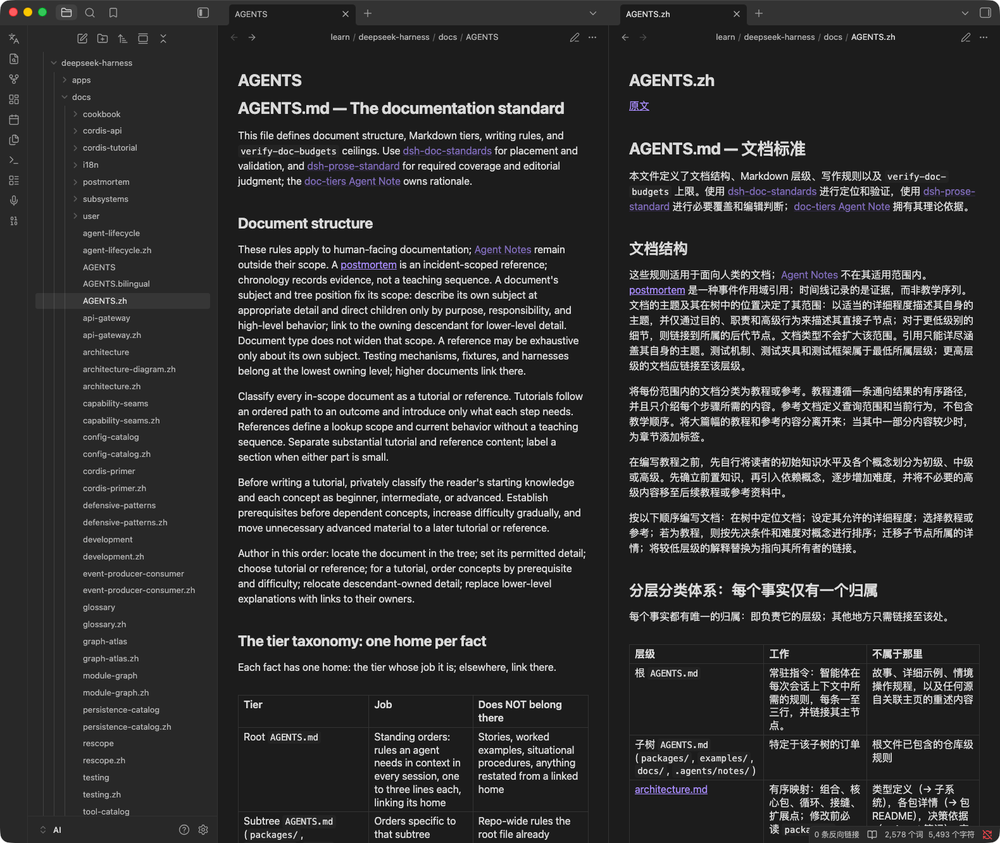
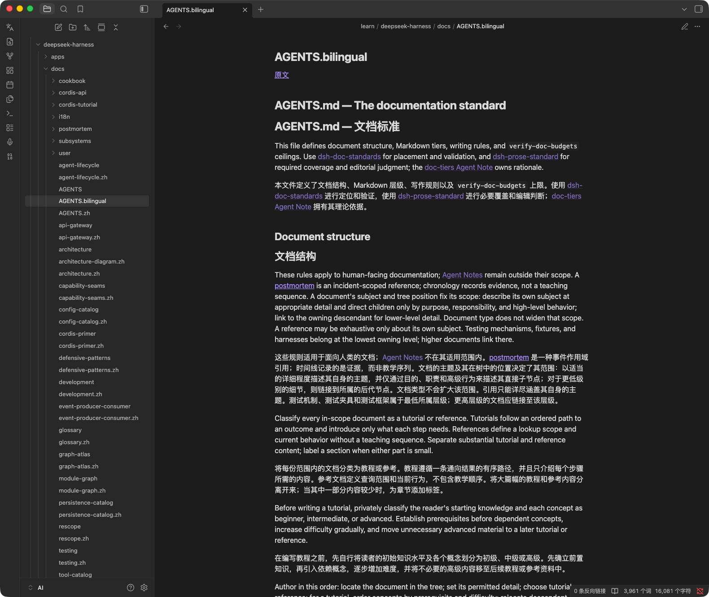

# 译读（Bilingual Reader）

读英文笔记时，一键生成对照译文。**原文永不改动**，译文另存为新文件，在右侧并排打开。

---

## 它解决什么问题

你在 Obsidian 里存了一堆英文资料——论文、文档、newsletter。读起来慢，但又不想让机翻污染原件。

译读的做法是：原文一个字都不碰，另外生成一份译文笔记，然后左右分屏摆在一起。读到哪儿卡住了，扫一眼右边就行。

- 原文只读，永不修改
- 译文首行自带回链，点一下跳回原文
- Markdown 格式、代码块、链接、图片路径都原样保留，不会被翻译搞乱
- 支持 11 种目标语言，不只中文

---

## 两种对照模式

同一篇原文，可以生成两种不同排布的译文，看你习惯哪种。

### 模式一：并排对照（生成 `xxx.zh.md`）

纯译文，一句原文都不夹带。翻译完成后自动在**右侧分屏**打开，左边是原文，右边是译文，眼睛左右扫。



**适合**：想沉浸式读译文，卡住时才回头看原文。这是默认推荐。

### 模式二：上下对照（生成 `xxx.bilingual.md`）

原文段落紧跟译文段落，交替排列，一个文件里读完。



**适合**：精读、学英语、需要逐句核对译文准确性的场景。

### 怎么选

设置里的**对照模式**有三个选项：

| 选项 | 生成什么 |
|---|---|
| **双语对照**（默认） | 两个文件都生成，并排的那份自动分屏打开 |
| **仅译文副本** | 只生成 `xxx.zh.md`（并排用） |
| **仅上下对照** | 只生成 `xxx.bilingual.md` |

> 文件名跟着目标语言变：中文是 `xxx.zh.md`，日语 `xxx.ja.md`，法语 `xxx.fr.md`。上下对照那份始终叫 `xxx.bilingual.md`。

---

## 安装

把 `manifest.json`、`main.js`、`styles.css` 三个文件放进你的库：

```
你的库/.obsidian/plugins/bilingual-reader/
```

然后在 **设置 → 第三方插件** 里启用「译读」。

（社区插件市场待提交，之后可直接搜索安装。）

### 第一次使用前

打开 **设置 → 译读**，填一个翻译服务：

- **LLM**（默认，推荐）——默认预置了 DeepSeek 厂商配置（`https://api.deepseek.com` / `deepseek-v4-flash`），填 API Key 即可用。你也可以自己加 OpenAI、OpenRouter、本地 Ollama 等任何 OpenAI 兼容的接口
- **Google** ——免费，不用配置，但质量一般
- **DeepL** ——需要填 DeepL 的 Key

---

## 使用

1. 打开要读的笔记
2. 点左侧栏的翻译图标，或按 `Cmd/Ctrl+Alt+B`，或命令面板搜「译读」
3. 顶部会显示「翻译中 45%」的进度，翻完自动分屏

长文档会分块并发翻译，稍等一会儿。

---

## 设置项

| 设置 | 说明 | 默认 |
|------|------|------|
| 目标语言 | 简体中文 / 繁體中文 / English / 日本語 / 한국어 / Français / Deutsch / Español / Русский / Português / Italiano | 简体中文 |
| 翻译引擎 | LLM / Google / DeepL | LLM |
| 默认 LLM 厂商 | 配了多个厂商时，选哪个当默认 | 第一个 |
| LLM 厂商管理 | 添加 / 编辑 / 删除厂商（名称、接口地址、Key、模型） | — |
| 对照模式 | 见上文「两种对照模式」 | 双语对照 |
| 生成后左右分屏 | 关掉的话译文只在当前页打开 | 开 |
| 译文打开模式 | 阅读模式 / 源码模式 / 跟原文一致 | 阅读模式 |
| 并发数 | 同时翻几块（1–8），越大越快但更容易触发限流 | 4 |

---

## 命令

| 命令 | 作用 |
|------|------|
| 译读（左右分屏） | 按当前设置翻译，默认热键 `Cmd/Ctrl+Alt+B` |
| 仅译文副本（左右分屏） | 只出并排那份 |
| 仅上下对照副本 | 只出上下交替那份 |
| 用指定 LLM 厂商翻译 | 临时换个厂商翻一次，不用改设置 |

---

## 关于隐私

API Key 只存在你自己库里的 `.obsidian/plugins/bilingual-reader/data.json`，不写进代码、不随插件分发。翻译请求由 Obsidian 直接发给你配置的服务商，不经过任何中间服务器。

需要注意：如果你的库通过 iCloud 或 Obsidian Sync 同步，`data.json` 会一起上云。介意的话建议用自托管接口，或给这个插件单独签一把 Key。

---

## License

MIT
